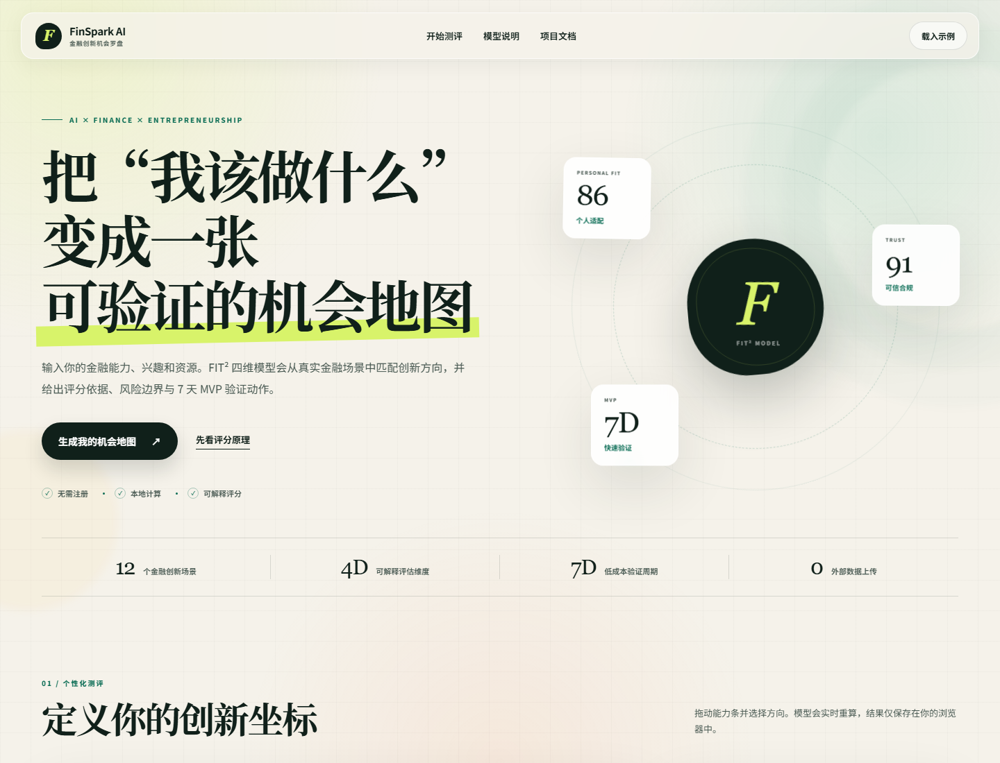

# FinSpark AI · 金融创新机会罗盘

> 面向金融专业学生的个性化创新机会发现作品。输入个人能力、兴趣和可投入资源，生成可解释的创新方向、FIT² 四维评分、7 天验证动作与商业闭环。

**在线作品：** https://yzme-5.github.io/finspark-ai/  
**项目仓库：** https://github.com/yzme-5/finspark-ai



## 为什么做这个作品

AI 时代真正的创新能力，不是让 AI 批量生成更多点子，而是把自己独特的专业能力、真实金融问题与可验证的资源条件连接起来。FinSpark AI 把这一过程产品化，帮助使用者从“我该做什么”走向“我下周能验证什么”。

项目围绕六个金融场景提供 12 个候选方向，包括小微企业现金流、信用解释、家庭财务韧性、行为金融、绿色金融、保险服务与县域普惠金融。

## 核心模型：FIT²

每个机会采用四个可解释维度：

```text
综合得分 = 0.35 × 个人适配 + 0.25 × 社会影响
         + 0.25 × 可验证性 + 0.15 × 可信合规
```

- **Fit 个人适配**：个人能力权重、所选金融领域与创新路径的匹配程度。
- **Impact 社会影响**：问题紧迫性、社会价值偏好和目标领域匹配。
- **Testability 可验证性**：时间投入、已有资源与项目复杂度之间的可实现程度。
- **Trust 可信合规**：个人风险审慎程度与场景本身的风险敏感度。

模型使用透明规则和固定场景库，所有计算都在浏览器本地完成，不上传用户输入。

## 真实产出

- 响应式交互网页，可直接用于课堂展示。
- 12 个金融创新场景与个性化前三名推荐。
- 个人能力雷达图与创新者画像。
- 首选机会的 MVP、商业闭环、风险边界和 7 天验证清单。
- 一键导出 A4 PDF 报告。
- 可复制带参数的分享链接，恢复同一份画像。
- Node.js 自动化测试，验证评分边界、领域匹配与资源敏感性。

## 本地运行

项目无第三方运行依赖。可以直接打开 `index.html`，也可以在项目目录启动任意静态服务器：

```bash
python -m http.server 8080
```

然后访问 `http://localhost:8080`。

运行模型测试：

```bash
npm test
```

## 目录

```text
.
├── index.html                    # 交互作品主页
├── assets/
│   ├── styles.css               # 页面样式与打印样式
│   ├── opportunities.js         # 12 个金融创新场景
│   ├── model.js                 # FIT² 评分模型
│   └── app.js                   # 交互、雷达图与分享逻辑
├── docs/
│   ├── 作品说明书.md
│   └── 商业计划书摘要.md
├── tests/model.test.js          # 自动化测试
└── screenshots/                 # 课堂提交用截图与 PDF
```

## 展示建议

1. 打开在线网页，点击“载入示例”。
2. 说明为什么创新需要“个性化匹配”，而不是让 AI 随机生成点子。
3. 调整一个能力或领域参数，展示推荐排序变化。
4. 下滚动到“首选方案拆解”，讲解 FIT² 评分、7 天 MVP 与风险边界。
5. 点击“导出 PDF 报告”，作为纸质版或电子版附件。

## 边界声明

本工具用于创新创业课程中的机会探索，不构成投资建议、信贷决策、保险销售或金融产品推荐。任何真实商业化应用都需要进一步完成监管、隐私、数据安全与算法解释评估。

## License

MIT
